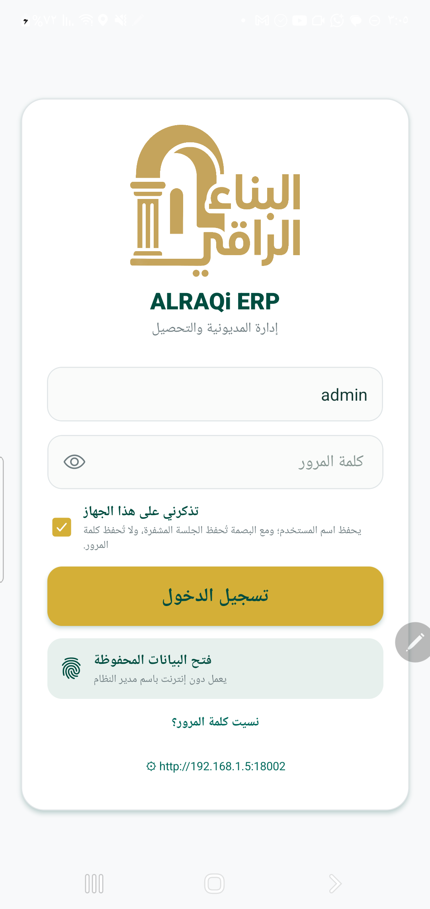
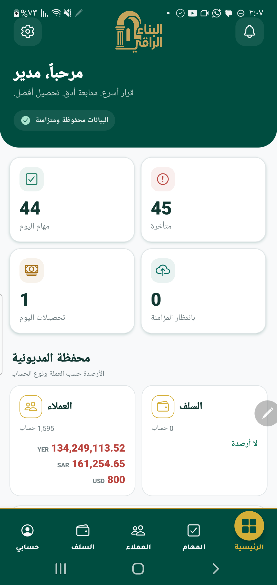
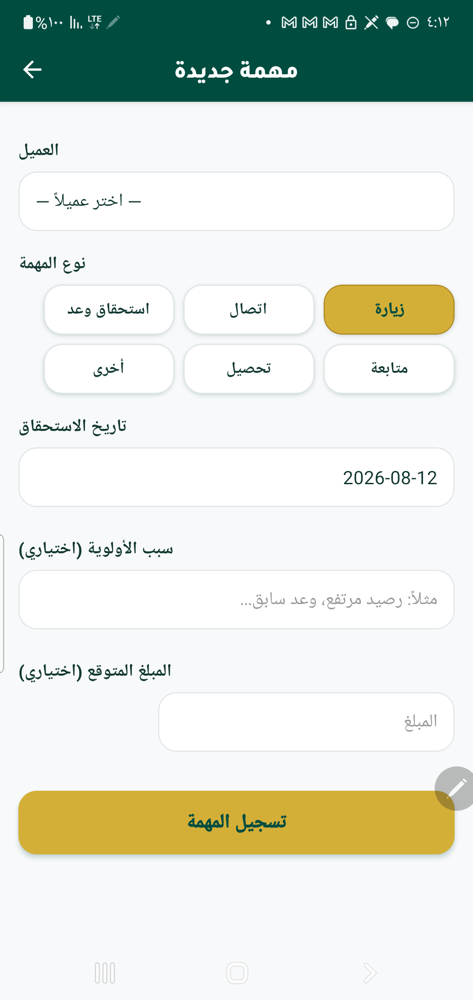

# دليل مستخدم تطبيق ALRAQi ERP من الصفر

## الفهرس

1. [قبل البدء](#1-قبل-البدء)
2. [التثبيت والدخول لأول مرة](#2-التثبيت-والدخول-لأول-مرة)
3. [فهم الشاشة الرئيسية](#3-فهم-الشاشة-الرئيسية)
4. [العملاء والسلف](#4-العملاء-والسلف)
5. [التواصل ودفتر الهاتف والموقع](#5-التواصل-ودفتر-الهاتف-والموقع)
6. [المهام والمتابعات والوعود](#6-المهام-والمتابعات-والوعود)
7. [تسجيل التحصيل](#7-تسجيل-التحصيل)
8. [العمل دون إنترنت والمزامنة](#8-العمل-دون-إنترنت-والمزامنة)
9. [الإشعارات والإعدادات](#9-الإشعارات-والإعدادات)
10. [حل المشكلات](#10-حل-المشكلات)

## 1. قبل البدء

اطلب من مدير النظام:

- اسم المستخدم وكلمة المرور المؤقتة.
- التأكد من ربط حسابك بسجل محصّل.
- إسناد العملاء والسلف المطلوبين إليك.
- عنوان الخادم في الشبكة المحلية، مثل `http://192.168.1.x:18002`.

يجب أن يكون الهاتف والكمبيوتر الخادم على الشبكة نفسها في المزامنة المحلية الأولى.

## 2. التثبيت والدخول لأول مرة

1. ثبّت ملف APK المعتمد من مسؤول النظام.
2. افتح التطبيق، واضغط عنوان الخادم أسفل شاشة الدخول إذا كان غير صحيح.
3. اكتب اسم المستخدم وكلمة المرور.
4. فعّل **تذكرني على هذا الجهاز** إن كان الهاتف خاصًا بك.
5. اضغط **تسجيل الدخول** وانتظر اكتمال المزامنة الأولى.
6. فعّل البصمة عند طلبها إذا أردت فتح البيانات المحفوظة لاحقًا.

> «تذكرني» يحفظ اسم المستخدم والجلسة المشفرة عند تفعيل البصمة، ولا يحفظ كلمة المرور كنص مكشوف.

## 3. فهم الشاشة الرئيسية

الشاشة الرئيسية تعرض:

- **مهام اليوم**: الأعمال المستحقة اليوم.
- **متأخرة**: أعمال تجاوزت موعدها.
- **بانتظار المزامنة**: عمليات محفوظة في الهاتف لم تصل للخادم بعد.
- **تحصيلات اليوم**: عدد التحصيلات المسجلة اليوم.
- **محفظة المديونية**: إجماليات العملاء والسلف منفصلة حسب العملة.
- **أولوية التواصل**: حسابات مدينة مقترحة للعمل اليوم؛ لا تظهر الأرصدة الدائنة.

الأزرار السفلية:

- الرئيسية: ملخص اليوم.
- المهام: قائمة العمل المرتبة حسب الأولوية.
- العملاء: العملاء المسندون.
- السلف: حسابات السلف المسندة، وتُعامل ميدانيًا مثل العملاء.
- حسابي: بيانات المستخدم والإعدادات والمزامنة.

## 4. العملاء والسلف

### البحث والفرز

1. افتح **العملاء** أو **السلف**.
2. ابحث بالاسم أو كود الحساب أو رقم الهاتف.
3. استخدم الترتيب حسب الأعلى رصيدًا أو الأحدث أو الاسم.
4. فعّل **استبعاد الصافي** لإخفاء الرصيد الصفري والدائن عند التركيز على التحصيل.

### فهم الرصيد

- المدين يظهر بالأحمر: مبلغ مطلوب تحصيله.
- الدائن يظهر بالأخضر: لا يُدرج ضمن أولوية التحصيل.
- الحساب الرئيسي قد يعرض رصيد الحسابات الفرعية مجمعًا، مع بقاء كل فرعي مستقلًا.

## 5. التواصل ودفتر الهاتف والموقع

من تفاصيل العميل:

- اضغط **اتصال** لاختيار الرقم عند وجود أكثر من رقم.
- اضغط **SMS** أو **WhatsApp** واختر قالب الرسالة والرقم.
- استخدم **إضافة أو تعديل أرقام العميل** لحفظ رقم أساسي، إضافي، ورقم واتساب.
- استخدم **اختيار رقم من دفتر الهاتف** ثم حدّد نوع الرقم.
- استخدم **حفظ العميل في جهات الاتصال** لحفظ جميع أرقامه الفريدة.
- استخدم **تعديل موقع العميل على الخريطة** لتحديد العلامة، و**فتح الموقع** للملاحة.

التعديلات تحفظ محليًا وتُزامن عند توفر الخادم. لا تغيّر أرقام عميل غير مسند إليك دون طلب تغيير الإسناد.

## 6. المهام والمتابعات والوعود

### تنفيذ مهمة

1. افتح **المهام** وابحث بالعميل أو الكود.
2. افتح الحساب أو المهمة.
3. اختر متابعة أو وعد سداد أو تحصيل بحسب نتيجة التواصل.
4. عند إتمام الإجراء تُغلق المهمة الحالية ولا تبقى في قائمة العمل النشط.

### إنشاء مهمة

اختر العميل، نوع المهمة، تاريخ الاستحقاق، سبب الأولوية، المبلغ المتوقع والعملة ثم اضغط **تسجيل المهمة**.

### تسجيل متابعة

1. اختر نوع التواصل ونتيجته واكتب ملاحظة واضحة.
2. إذا كانت النتيجة ليست **تم السداد**، أدخل موعد المتابعة القادم.
3. يقبل التاريخ الإدخال الذكي: `128` يعني 12/08 من السنة الحالية، و`1282026` يعني 12/08/2026.
4. سجّل المعلومة التي يحتاجها المحصل التالي، لا عبارة عامة مثل «تم التواصل» فقط.

### وعد السداد

سجّل المبلغ والعملة والتاريخ والملاحظات. يظهر الوعد في قائمة الوعود والإشعارات عند قرب الاستحقاق أو التأخير.

## 7. تسجيل التحصيل

1. افتح حساب العميل واضغط **تحصيل**؛ يُحدد العميل تلقائيًا.
2. اكتب المبلغ واختر العملة وطريقة التحصيل والفرع.
3. راجع التاريخ والوقت المرجعي وأضف الملاحظة أو المرجع.
4. اضغط **تسجيل التحصيل** مرة واحدة.
5. صوّر السند أو اختره من الصور إن طلب النظام ذلك.

تنبيهات مهمة:

- لا تكرر الضغط عند بطء الشبكة؛ النظام يستخدم مفتاح منع تكرار، لكن المراجعة واجبة.
- لا تسجّل تحصيلًا تجريبيًا على بيانات حقيقية.
- عكس التحصيل يتم بطلب ومراجعة، وليس بحذف السجل.
- إذا كان الهاتف دون اتصال يظهر التحصيل محليًا ويصل للخادم بالمزامنة.

## 8. العمل دون إنترنت والمزامنة

بعد دخول ومزامنة ناجحين لأول مرة:

- يمكن إغلاق التطبيق أو إعادة تشغيل الهاتف وفتح البيانات المحفوظة.
- تبقى البيانات والعمليات في SQLite لأكثر من شهر ما لم تُحذف بيانات التطبيق من إعدادات Android.
- يمكن إنشاء متابعة ووعد وتحصيل ومهمة وتحديث هاتف أو موقع دون اتصال.
- عند العودة للشبكة المحلية اضغط **مزامنة الآن**.
- راقب عداد **بانتظار المزامنة** حتى يعود إلى صفر.

### عمليات تحتاج مراجعة

إذا رفض الخادم عملية بسبب صلاحية أو بيانات:

1. افتح الإعدادات وحالة المزامنة.
2. اقرأ سبب الرفض.
3. صحح البيانات أو اطلب الصلاحية من المدير.
4. اضغط إعادة المحاولة؛ لا تحذف العملية قبل التحقق من وصولها.

## 9. الإشعارات والإعدادات

- افتح الجرس لمراجعة التحصيلات والوعود وطلبات تغيير الإسناد والقرارات.
- علّم الإشعار كمقروء بعد التعامل معه.
- من الإعدادات يمكنك تغيير الخادم أو المستخدم واختبار الاتصال دون حذف البيانات المحلية.
- خيار **المزامنة عبر الشبكة المحلية فقط** يمنع إرسال البيانات إلى عنوان خارجي.
- يمكن تشغيل/إيقاف تنبيهات المهام والوعود وتغيير نغمة الإشعار.

## 10. حل المشكلات

| المشكلة | الحل |
|---|---|
| تعذر الاتصال بالخادم | تأكد من Wi-Fi نفسه، عنوان الكمبيوتر الحالي، المنفذ `18002`، وافتح `/health` من الهاتف |
| يعمل دون اتصال رغم وجود Wi-Fi | اختبر عنوان الخادم؛ وجود Wi-Fi لا يعني الوصول للكمبيوتر |
| العملاء غير ظاهرين | اطلب من المدير مراجعة الإسناد ودور المحصّل ثم نفّذ مزامنة |
| عملية تحتاج مراجعة | افتح تفاصيل الخطأ، صحح السبب، ثم أعد المحاولة |
| البصمة لا تفتح | يلزم دخول ناجح أول مرة وتفعيل تذكرني وبصمة Android |
| دفتر الهاتف لا يفتح | امنح إذن جهات الاتصال من إعدادات Android ثم أعد المحاولة |
| زر تغطيه لوحة المفاتيح | استخدم الإصدار 1.3.11 أو أحدث |

عند الإبلاغ عن مشكلة أرسل: الشاشة، الوقت، اسم الوظيفة، وهل كان الهاتف متصلًا، ولا ترسل كلمة المرور.
