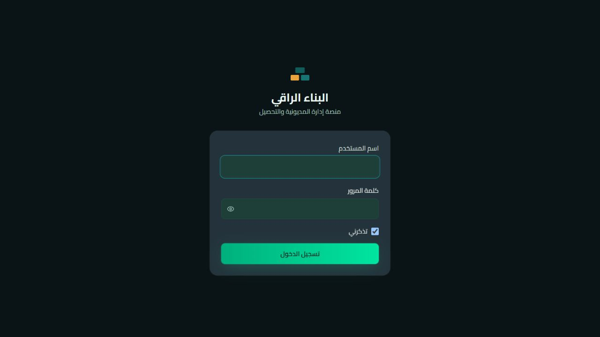

# دليل مستخدمي نظام البناء الراقي حسب الدور

## الفهرس

1. [الدخول والأمان](#1-الدخول-والأمان)
2. [الأدوار والمسؤوليات](#2-الأدوار-والمسؤوليات)
3. [تهيئة النظام أول مرة](#3-تهيئة-النظام-أول-مرة)
4. [دورة العمل اليومية](#4-دورة-العمل-اليومية)
5. [العملاء والسلف](#5-العملاء-والسلف)
6. [التحصيل والرقابة](#6-التحصيل-والرقابة)
7. [الاستيراد وجودة البيانات](#7-الاستيراد-وجودة-البيانات)
8. [التقارير والمؤشرات](#8-التقارير-والمؤشرات)
9. [الحجوزات](#9-الحجوزات)
10. [إدارة المحصلين والتطبيق](#10-إدارة-المحصلين-والتطبيق)

## 1. الدخول والأمان

1. افتح عنوان النظام الذي يزودك به المسؤول.
2. اكتب اسم المستخدم وكلمة المرور الخاصة بك فقط.
3. لا تستخدم حساب المدير للأعمال اليومية إذا كان دورك محاسبًا أو محصّلًا.
4. غيّر كلمة المرور المؤقتة ولا ترسلها عبر WhatsApp أو البريد.
5. سجّل الخروج عند استخدام جهاز مشترك.

إذا ظهرت رسالة تعذر الاتصال بالخادم، افحص خدمة API والشبكة قبل إعادة المحاولة المتكرر.

## 2. الأدوار والمسؤوليات

| الدور | الاستخدام الصحيح |
|---|---|
| مدير النظام | المستخدمون، الأدوار، الفروع، الإعدادات، النسخ، التدقيق الفني؛ لا ينفذ ويعتمد العملية الحساسة نفسها |
| مدير المديونية | متابعة المحفظة، الأولويات، الإسناد، المخاطر، طلبات تغيير الإسناد والحمل الجماعي |
| المحاسب | التحقق من الأرصدة، التحصيلات، المطابقة، العكس، الفترات والتقارير المالية حسب الصلاحية |
| المحصّل | العملاء المسندون، المتابعات، الوعود، التحصيلات والمهام من الهاتف أو الويب |
| قراءة فقط | العرض والتقارير المسموح بها دون إنشاء أو تعديل أو اعتماد |

الصلاحية الفعلية هي ما يظهر للمستخدم؛ اسم الدور وحده لا يكفي. راجع صفحة **الأدوار والصلاحيات** عند أي تعارض.

## 3. تهيئة النظام أول مرة

ترتيب التهيئة المقترح:

1. الإعدادات وهوية الشركة وترويسة كشف الحساب.
2. العملات ووحدات الحجز والفروع.
3. المستخدمون ثم الأدوار والصلاحيات.
4. إنشاء سجلات المحصلين وربطها بالمستخدمين.
5. استيراد العملاء والسلف والحركات في بيئة اختبار أولًا.
6. مراجعة جودة البيانات والتكرارات والأرصدة.
7. إسناد العملاء للمحصلين.
8. تشغيل توليد مهام اليوم ومراجعة الأولويات.
9. اختبار تحصيل وعكسه على حساب اختبار معتمد.

## 4. دورة العمل اليومية

### بداية اليوم

- راجع لوحة التحكم والمطابقة بين إجمالي المحفظة وعمل اليوم.
- راجع العملاء +120 يوم، المخاطر العالية، الوعود المستحقة والمتأخرة.
- راجع المهام غير المسندة وحمل كل محصل.
- وزع المهام حسب المبلغ، عمر الدين، حداثة المديونية، الوعد السابق والمنطقة.

### أثناء اليوم

- تابع التحصيلات الجديدة والقسائم وطلبات تغيير الإسناد.
- لا تغيّر بيانات مالية بناءً على اتصال شفهي دون مستند أو أثر تدقيق.
- عالج العمليات التي تحتاج مراجعة من الهواتف.

### نهاية اليوم

- طابق الصندوق والقسائم مع تحصيلات النظام.
- راجع العمليات المعكوسة والمعلقة.
- افحص فروق الأرصدة حسب العملة ونوع الحساب.
- تأكد من مزامنة هواتف المحصلين وصدور نسخة احتياطية.

## 5. العملاء والسلف

### إضافة وتعديل عميل

- من قائمة العملاء استخدم **إضافة عميل**.
- رقم الحساب التحليلي هو المرجع الأساسي عند الاستيراد.
- أدخل الاسم، الأرقام، WhatsApp، العنوان، الموقع، الفرع، المحصل والسياسة الائتمانية.
- يمكن ربط عدة حسابات فرعية بحساب رئيسي دفعة واحدة؛ لا يتغير سجل الفرعي.

### حسابات السلف

السلف هنا «سلف على الغير» وليست سلف موظفين. لها تبويب مستقل، لكنها تستخدم نفس أدوات المتابعة والوعود والتحصيل والتواصل الخاصة بالعملاء.

### التكرارات

1. افتح **جودة البيانات**.
2. راجع أزواج التشابه، خاصة الأسماء المنتهية برقم أو اختلاف هجائي بسيط.
3. تحقق من الكود والحركات والعملة قبل الدمج.
4. اختر السجل الرئيسي ونفذ الدمج؛ توجد مهلة/إمكانية تراجع بحسب النظام.
5. لا تدمج فروعًا صحيحة للعميل نفسه لمجرد تشابه الاسم.

## 6. التحصيل والرقابة

- إنشاء التحصيل يغير الرصيد ويولد إيصالًا وأثر تدقيق.
- العكس ينشئ قيدًا مضادًا ولا يحذف الأصل.
- منشئ طلب العكس لا يعتمد طلبه عند تطبيق فصل المهام.
- راجع تاريخ التحصيل بتوقيت Asia/Aden واليوم المحاسبي.
- المطابقة تفصل القسيمة، التحصيل، التسليم، والاعتماد.
- أقفل الفترة المحاسبية فقط بعد المطابقة والنسخ الاحتياطي.

## 7. الاستيراد وجودة البيانات

### قبل الاستيراد

- خذ نسخة احتياطية.
- استخدم ملفًا تجريبيًا أو معاينة أولًا.
- لا تعتمد الحساب الرئيسي الموجود في Excel إذا كانت السياسة تعتمد رقم الحساب التحليلي.
- لا تخلط ملف العملاء بملف السلف.
- وحّد أكواد العملة والتاريخ وترميز الأسماء.

### بعد الرفع

1. راجع عدد الصفوف والمستورد والمستبعد والأخطاء.
2. راجع صافي التغير بين استيرادين متجانسين والحسابات المتأثرة.
3. افتح تقرير جودة البيانات قبل الاعتماد النهائي.
4. طابق عينة من كشوف الحساب والإجماليات بكل عملة.
5. عند الخطأ استخدم التراجع الموثق بدل حذف السجلات يدويًا.

## 8. التقارير والمؤشرات

- **أعمار الديون**: راقب 30/60/90/120+ لكل نوع حساب وعملة.
- **المخاطر**: مؤشر قرار وليس بديلًا عن مراجعة المحاسب.
- **CEI**: يحتاج لقطة بداية ونهاية ومبيعات/ائتمان للفترة.
- **DSO**: يحتاج مبيعات آجلة مؤرخة؛ إذا كانت البيانات غير مكتملة يظهر غير متاح بدل رقم مضلل.
- **متوسط عمر الدين**: يعتمد على حركات مؤرخة لا رصيد افتتاحي غير مؤرخ فقط.
- **تركيز المخاطر**: نسبة أكبر العملاء من المحفظة.
- **كشف الحساب**: اختر الفترة والعملة والقالب ثم المعاينة قبل التنزيل.

لا تجمع YER وSAR وUSD في رقم واحد دون أسعار صرف معتمدة ومؤرخة.

## 9. الحجوزات

- أنشئ الحجز بالعميل والكمية والوحدة والسعر والعملة.
- يعرض النظام متوسط سعر الطن حسب عملة الحجز أو العملة المختارة.
- حدّث الحالة عند الصرف أو الإلغاء مع الحفاظ على السجل.
- راقب الكمية المحجوزة وغير المصروفة ولا تعتبر الحجز تحصيلًا.

## 10. إدارة المحصلين والتطبيق

### إضافة مستخدم هاتف

لا توجد حسابات هاتف منفصلة:

1. أنشئ المستخدم من **الإدارة ← المستخدمون**.
2. أنشئ/اختر دورًا بصلاحيات المحصّل.
3. أنشئ سجل المحصّل واربطه بالمستخدم.
4. أسند إليه الحسابات.
5. أعطه عنوان API المحلي وبيانات دخوله المؤقتة.
6. راقب أول مزامنة ثم غيّر كلمة المرور.

### طلب تغيير الإسناد

- يصل الطلب إلى مدير النظام أو مدير المديونية أو المحاسب المخول.
- راجع السبب، العميل، المحصل الحالي والحمل قبل القبول.
- الرفض أو القبول يولد إشعارًا وسجل تدقيق.
- لا يتغير الإسناد بمجرد إرسال الطلب.

### أفضل الممارسات

- راجع الإسناد أسبوعيًا حسب المنطقة والحمل.
- لا تمنح `customers.read_all` للمحصّل العادي.
- استخدم الإسناد الجماعي الذكي ثم راجع المعاينة قبل التنفيذ.
- افصل حساب القراءة فقط لاختبارات الإدارة والعرض.
